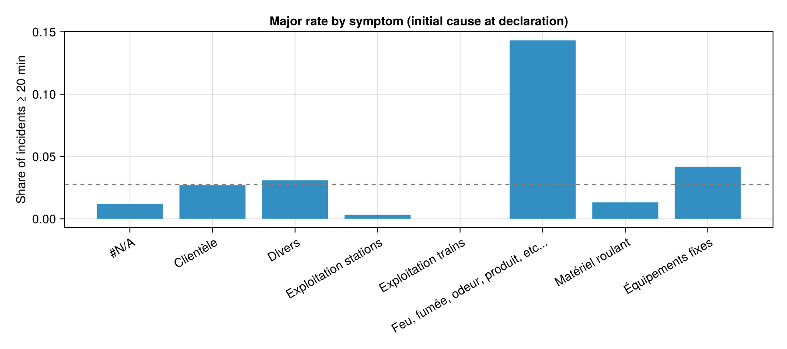

# Predicting major STM metro interruptions

A framework for flagging **major Montréal metro interruptions at the moment an incident is declared**, built on the STM open data (incidents 2019-01 → 2025-09), with recommendations on how the STM should measure reliability, prioritise action and improve its data.

## How to run

From the repo root, with Julia 1.12:

```
julia --project=. -e "using Pkg; Pkg.instantiate()"   # install packages (first time only)
julia --project=. analysis/run-all.jl                 # rebuild the feature table and all results
julia --project=. test/runtests.jl                    # unit tests for the helper functions
```

| Script | What it does | Writes |
| --- | --- | --- |
| `analysis/exploration/incidents-feature.jl` | Builds the target and features from the raw incidents file | `data/df.csv`, `analysis/csv/`, `analysis/plots/` |
| `analysis/model/baseline.jl` | Symptom-only rule | `analysis/results/baseline_*` |
| `analysis/model/decision-tree.jl` | Decision tree, tuned on the yearly folds | `analysis/results/decision_tree_*` |
| `analysis/model/xgboost-model.jl` | XGBoost, tuned on the yearly folds | `analysis/results/xgboost_*` |
| `analysis/model/compare.jl` | Side-by-side tables of the three models | `analysis/results/model_comparison_*` |

`run-all.jl` runs the five scripts above in order. Shared code lives in `analysis/exploration/utils.jl` (parsing and plotting helpers) and `analysis/model/setup.jl` + `metrics.jl` (split, folds, metrics). `analysis/exploration/incidents-data.jl` and `planned_km-data.jl` are the column-by-column exploration of the two raw files; they aren't needed to reproduce the results.

---

## 1. Framing: what are we predicting, and when?

The business ask is earlier escalation and better prioritisation, so a prediction is only useful **before** the outcome is obvious:

> When a train incident is declared, how likely is it to cause 20 minutes or more of customer delay?

This choice drives every feature decision. A model that "predicts" a major interruption from the fact that a train was evacuated is accurate but useless for escalation.

## 2. Data and what it can support

| Source | Coverage | Used for |
| --- | --- | --- |
| Incidents (`data/raw/Incidents métro_*.xls`) | 45,561 incidents, 2019-01-01 → 2025-09-30 | Target, features, evaluation |
| Planned km (`data/raw/Kilométrage métro planifé_*.xls`) | Per line and day, 2019-01-01 → 2023-09-30 | Not used (see below) |

What exploration showed ([`analysis/exploration/`](analysis/exploration/)):

1. **The duration is a text band, not a number.** `Incident en minutes` has 8 bands from "02 min et moins" to "30 min et plus" ([`delay_bands.csv`](analysis/csv/delay_bands.csv)). It is not defined in the STM data dictionary.
2. **Times after midnight use a service clock.** 2,316 start times and 3,268 resume times are written as `HH:MM:SS` with hours of 24 or more (e.g. `25:26:00`). All other times are `HH:MM` before 24:00. Every time is read as minutes since the start of the service day.
3. **Start/resume times mean different things by incident type.**
  a. For train incidents, resume − start falls inside the official band 92.5–99.8% of the time.
  b. For station incidents, only 4.5%: their median is 41 minutes while every one is in the "≤ 2 min" band ([`minutes_vs_band.csv`](analysis/csv/minutes_vs_band.csv)).
4. **Causes are recorded after the fact.** `Cause primaire` and `Cause secondaire` are "determined following analysis of the incident" per the dictionary, and are always `Autres` for station incidents. `Symptome` is the cause recorded *at the moment of the incident*.
5. **Some flags record the response, not the incident.** 90% of incidents with a train-and-station evacuation are major, vs 1% with no evacuation ([`major_rate_by_evacuation.csv`](analysis/csv/major_rate_by_evacuation.csv)).
6. **One line value is corrupted.** `02-avr` is an Excel date rendering of a line combination; that incident is removed (see §4).
7. **Planned km stop two years early.** The extract ends on 2023-09-30 while incidents run to 2025-09-30, so km cannot be a feature, and rates per km cannot cover the validation and test years.

## 3. Target

`target = 1` when the official band is `20 à 24 min`, `25 à 29 min` or `30 min et plus`, for train incidents.

- **Why the official band and not resume − start:** the band is STM's own customer-delay measure for every incident; the recomputed minutes only mean customer delay for train incidents. Train incidents whose minutes disagree with their band (646 incidents, 1–8% per band) are kept, since the label comes from the band. Some of their recomputed minutes are recording errors (up to ~1,200 minutes for a "≤ 2 min" incident), so for delay totals (delay share, `delay_captured`) each incident's minutes are clamped to its band.
- **Why 20 minutes:** in Abolfazli (2024, Polytechnique Montréal, STM data), incidents with a primary delay above 20 minutes fall predominantly in the high-severity cluster (≈ 26 trains affected, ≈ 4.5 h of total train delay on average); 5–20 minutes is the medium cluster. Thesis in [`docs/`](docs/).
- **Why train incidents only:** no station incident exceeds 2 minutes of customer delay, so including them would add 16,394 rows the model gets right for free and inflate every metric.
- **Why it matters:** majors are 2.8% of train incidents but about 36% of customer-delay minutes (median 37 minutes each).

## 4. Features

For each candidate, the share of major incidents per value was checked before deciding (`analysis/exploration/incidents-feature.jl`).

| Feature | Encoding | Evidence (share of majors) |
| --- | --- | --- |
| Symptom (initial cause at declaration) | One column per symptom; missing (`#N/A`) is the reference. "Exploitation trains" and "Exploitation stations" are merged | Fire/smoke/odour **14.3%**, fixed equipment 4.2%, customer 2.7%, rolling stock 1.3%, operations 0.1% ([table](analysis/csv/major_rate_by_symptom.csv)) |
| Line(s) | One flag per line (1, 2, 4, 5) plus `multi_line` | Incidents on several lines **23.4%** vs 2.5% |
| Hour of the service day | Number (24, 25 = after midnight); the tree models find the cut-offs | [Figure](analysis/plots/major_rate_by_hour.png) |
| Month | Number (1–12) | 2.2–3.5%; higher in March, April, June, November and December ([figure](analysis/plots/major_rate_by_month.png)) |
| Day of week | Number (1–7) | Small differences ([figure](analysis/plots/major_rate_by_day_of_week.png)); weekend 2.77% vs weekday 2.75% |
| Day of month | Number (1–31) | Some days above average ([figure](analysis/plots/major_rate_by_day_of_month.png)) |
| Rolling stock | `tm_73`, `tm_10`; "Non affecté" is the reference | MPM-10 2.4%, MR-73 1.3%, none assigned 3.0% |
| Emergency brake (`kfs`) | 0/1 | 2.1% vs 2.8% |
| Door involved (`porte`) | 0/1 | **0.3%** vs 3.0%: door incidents are rarely major |



**No feature selection** Every candidate known at declaration is given to the models, including the calendar features whose signal is weak. The tree models can ignore inputs that don't help.

**Excluded**

| Columns | Why |
| --- | --- |
| `cause_primaire`, `cause_secondaire` | Set after post-incident analysis: not known at declaration |
| `evacuation`, `urgence_metro`, `cat`, `dommage_materiel` | Recorded during the response, without a time stamp. `urgence_metro` is the escalation decision itself. `dommage_materiel` flags *possible* damage to the train, which is assessed by inspecting the train once it has stopped. `cat` (power cut) is the borderline case: it can be the trigger or a response measure |
| `heure_de_reprise`, `incident_en_minutes` | Define the outcome |
| `numero_dincident`, `numero_de_tournee`, `vehicule`, `code_de_lieu`, `porte_de_voiture` | Identifiers or too many distinct values; door numbers are covered by `porte` |
| One incident with line `02-avr` | Excel turned the line value into a date; the original line(s) can't be recovered with certainty, so the incident (a 5–9 minute train incident from August 2025) is removed rather than guessed |

## 5. Validation strategy

- **Time-based split.** Development set 2019–2024 (26,120 incidents, 711 majors); test set 2025 January–September (3,046 incidents, 93 majors), scored **once** per model. A random split would let models learn from future incidents.
- **Expanding-window cross-validation by year** inside the development set: train on 2019–2020 → validate on 2021, then 2019–2021 → 2022, 2019–2022 → 2023, 2019–2023 → 2024. 
  - Hyperparameters are chosen on the mean PR-AUC of the four folds. 

## 6. Success metrics

With 2.8% positives, accuracy is meaningless: "never major" is 97% accurate.

- **PR-AUC** (primary): does the score put major incidents first? A random ranking scores the share of majors (≈ 0.03).
- **At the top 1% of incidents**, the list the control room would act on:
  - **precision**: share of predictions that become major;
  - **lift**: precision ÷ share of majors, i.e. how many times better than a random prediction (~3%);
  - **alerts per month**: the workload the list creates; (would be useful once we setup the cutoff on how many alerts we would have to handle)
  - **delay captured**: share of all major-incident delay minutes covered by the flags (`delay_captured`);
  - **severe recall**: share of the 30+ minute incidents that were flagged (`severe_recall`).

## 7. Models

> **No cut-off yet.** Each model outputs a score (an estimated probability of a major interruption), not a yes/no. For evaluation, an incident counts as flagged when it is in the top 1% of scores, so all models are compared at the same workload. The operational cut-off (the score above which an incident is escalated) is left for a later step, to be set with Operations using:
> - **alert budget**: how many escalations per month the control room can handle;
> - **acceptable false alarms**: the share of escalations, and of public messages, that may turn out not to be major;
> - **severe incidents caught**: the minimum share of 30+ minute incidents the list must flag;
> - **cost of a miss vs a false alarm**: once the financial burden of a major interruption can be estimated (§9);
> - **calibration**: check that a score of, say, 0.3 really means about 30% of such incidents become major before reading scores as probabilities.


All three models go through the same steps ([`analysis/model/setup.jl`](analysis/model/setup.jl)): load `data/df.csv`, split by time, build the yearly folds, then for every hyperparameter setting fit on each fold's training years and score its validation year. 

The setting with the best mean PR-AUC is refit on 2019–2024 and scored once on 2025. Each model only defines how it is fitted and how it scores incidents (`fit_model!`, `predict_model`), so the comparison is like for like.

| Model | Role | Chosen setting |
| --- | --- | --- |
| **Symptom-only rule** | Baseline: score = share of majors for the incident's symptom. The simplest rule the control room could already apply | — |
| **Decision tree** | Interpretable: a handful of if/then rules operations can read | Depth 5, minimum 20 incidents per leaf (16 settings searched) |
| **XGBoost** | Flexible: tests whether interactions or non-linear effects add signal | Depth 2, learning rate 0.03, 300 trees, minimum child weight 1, 80% row and column sampling, no class weighting (64 settings searched) |

## 8. Results

**Cross-validation PR-AUC** (each year predicted from all earlier years; [`model_comparison_cv.csv`](analysis/results/model_comparison_cv.csv)):

| Model | Mean | 2021 | 2022 | 2023 | 2024 |
| --- | --- | --- | --- | --- | --- |
| Symptom only | 0.073 | 0.076 | 0.076 | 0.061 | 0.078 |
| Decision tree | 0.108 | 0.105 | 0.052 | 0.102 | 0.175 |
| XGBoost | **0.143** | **0.142** | **0.089** | **0.138** | **0.201** |

**2025 test set** (3,046 incidents, 93 majors, 9 months; [`model_comparison_test.csv`](analysis/results/model_comparison_test.csv)):

| Model | PR-AUC | Top 1%: precision | Lift | Alerts per month | Delay captured | Severe recall |
| --- | --- | --- | --- | --- | --- | --- |
| Symptom only | 0.106 | 35% | 12× | 3.4 | 9% | 9% |
| Decision tree | 0.224 | **61%** | **20×** | 3.4 | 18% | 20% |
| XGBoost | **0.248** | **61%** | **20×** | 3.4 | 18% | **22%** |

*Note on the symptom rule: it gives every fire/smoke incident the same score. In 2025 there are 100 fire/smoke incidents but the top-1% list only has room for 31, so the 31 that get flagged are simply the first ones in the file. Its top-1% numbers are therefore a rough guide; compare it with the other models on PR-AUC, which is not affected.*

**Reading the results**

- **XGBoost beats the symptom rule in every validation year and on 2025; the decision tree in three of four years and on 2025.** The tree falls below the symptom rule in 2022 (0.052 vs 0.076). The gain is largest where it is used: on 2025 the top-1% list is right 6 times in 10, against 3.5 for the symptom rule.
- **Best on the latest fold.** Both models score best on 2024, the fold trained on the most years. More history is a likely reason, but 2024 also has the highest share of majors (3.1%), which raises PR-AUC on its own, so this is suggestive rather than proven.

## 9. Recommendations

Each recommendation is marked by its source: **[analysis]** follows from the results above; **[needs data]** depends on information this extract does not contain.

**VP Operations: earlier escalation, less disruption**
- **[analysis]** Escalate the top 1% of new train incidents at declaration: about 3–4 a month, of which about 60% become major.
- **[analysis]** Treat fire/smoke/odour symptoms (14% become major, 5× the average) and incidents on more than one line (23%) as escalate-by-default.

**CFO: prioritisation, confidence, financial burden**
- **[analysis]** Prioritise major interruptions: they are 2.8% of train incidents but about 36% of customer-delay minutes.
- **[analysis]** Confidence: XGBoost beats the symptom rule in all four validation years and on 2025; the decision tree in three of four years and on 2025.
- **[needs data]** Financial burden: delay minutes × riders affected × cost per rider-minute. The last two are not in this data.

**Public Affairs / Safety: user impact, communication risk, rare severe events**
- **[analysis]** A pre-emptive message triggered by the top-1% flag would be unnecessary about 4 times in 10.
- **[analysis]** The top-1% list flags only about 20% of 30+ minute incidents; communication plans should not rely on prediction for the longest disruptions. [`analysis/results/model_comparison_test.csv`]
- **[needs data]** User impact: record riders or trains affected, not only delay length.

**Data collection**
1. **Record user impact:** riders or trains affected and total train delay.
2. **Extend planned km to the full incident period**, and add delivered km and ridership by line.

## 10. Limitations

- **Small positive counts:** 93 majors in the 2025 test set and 111–157 per validation year, so single-year metrics can move a lot from one year to the next.
- **Incomplete recent months:** STM notes some incidents are published over 30 days after month close, which affects the end of the test period.
- **Banded label:** the 20-minute cut is defensible but a threshold; bands are 5 minutes wide.
- **No operational cut-off:** results are reported for the top 1% of scores; the escalation threshold is to be set later.
- **Data Not explored:** station-level history (230 locations, needs grouping), and feature selection: all onset features are used, including calendar features with weak signal.
